# Highrise House

A procedural Blender model of a high-rise residential complex composed of two independently configured apartment towers, a continuous curved glass podium, open pilotis levels, sky gardens, and landscaped roofs. The project explores facade rhythm, public space, structure, and lighting at the scale of a dense vertical development.

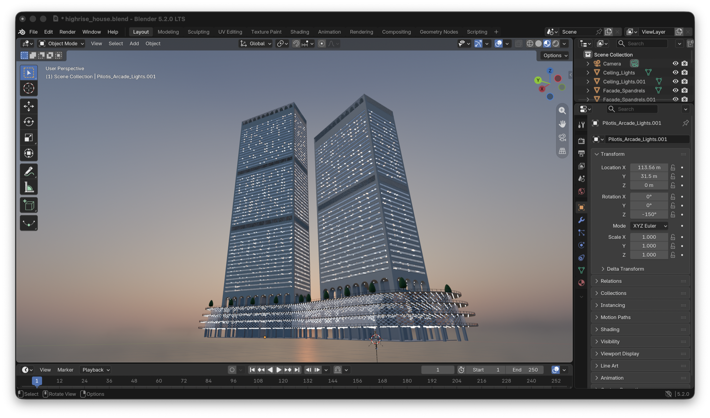

The image above captures the current Blender working view. The images below are rendered from the same saved `.blend` scene.

## Project Overview

| Item | Specification |
| --- | ---: |
| Towers | 2 |
| Existing tower | 76 × 40 m; approximately 193.94 m to the core top |
| Adjacent tower | 84 × 40 m; approximately 269.94 m to the core top |
| Clear gap between towers | 30 m |
| Typical floor-to-floor height | 4 m |
| Residential facade module | 4 × 1.5 m window module |
| Podium depth | 60 m |
| Render engine | Blender EEVEE |

## Design Features

- **Twin residential towers:** each tower keeps its own height, room-module count, and service-core configuration, producing an asymmetrical skyline.
- **Continuous curved podium:** the podium extends beneath both towers and across the connector, using a smooth 120-degree central arc rather than disconnected rectangular wings.
- **Open public base:** pilotis lift the towers above a permeable ground level, while elevated galleries, guardrails, and planted terraces form a continuous public edge.
- **Horizontal facade rhythm:** pale stone bands, dark metal mullions, and neutral clear glass create long ribbon elevations. Windows, ventilation bands, and wall surfaces remain flush on one facade plane.
- **Sky gardens and refuge floors:** double-height openings combine vertical screens, planting, balustrades, exposed cores, and perimeter structure.
- **Landscaped roofs:** low planting and perimeter screens terminate both tower and podium volumes.
- **Legible structure:** twin service cores continue through each tower, with exposed trusses and outrigger elements marking the taller tower's sky-garden levels.
- **Layered lighting:** deterministic warm and cool room lights create a scattered, star-like pattern behind the glazing, while dense circular fixtures illuminate the podium soffits and pilotis arcades.

## Main Views

| Ground-Up Twin-Tower View | Ground-Up Podium Corner |
| --- | --- |
|  |  |
| The camera sits at ground level and looks steeply upward between both towers, emphasizing their height and scattered interior lights. | A second ground-level camera looks upward from the podium corner, placing the illuminated soffit, pilotis, and both towers in the same frame. |

| Podium and Pilotis | Sky Garden |
| --- | --- |
| 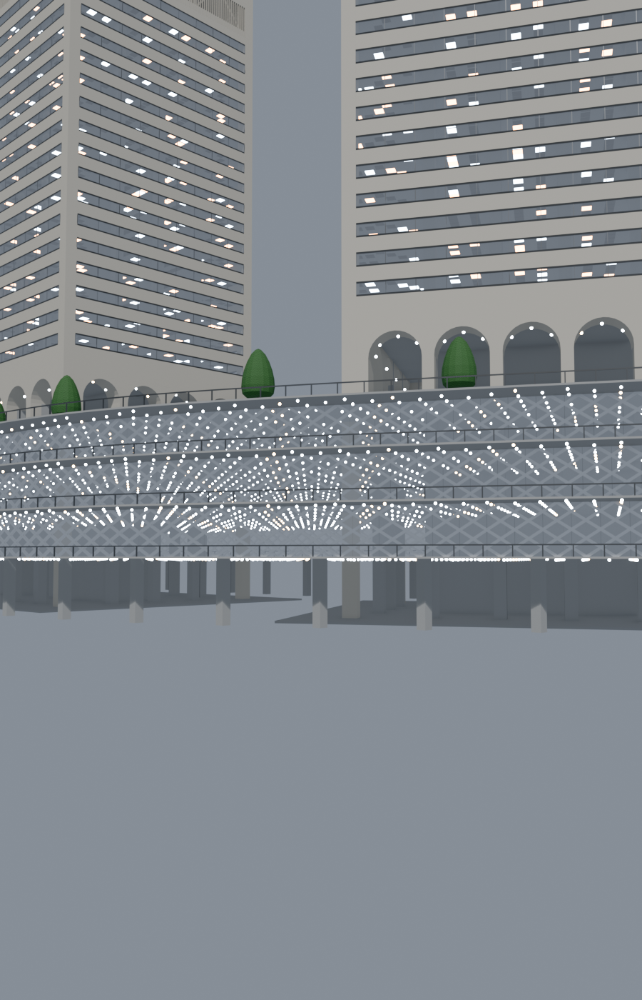 | 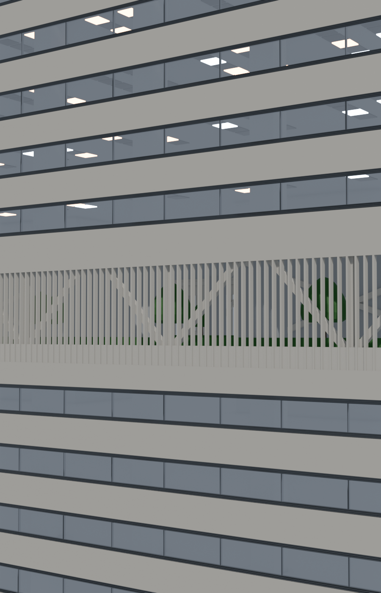 |
| A close view of the open base, columns, public galleries, guardrails, and illuminated podium underside. | The double-height planted refuge level, vertical screen, glazing, and structural frame. |

| Facade Detail |
| --- |
| 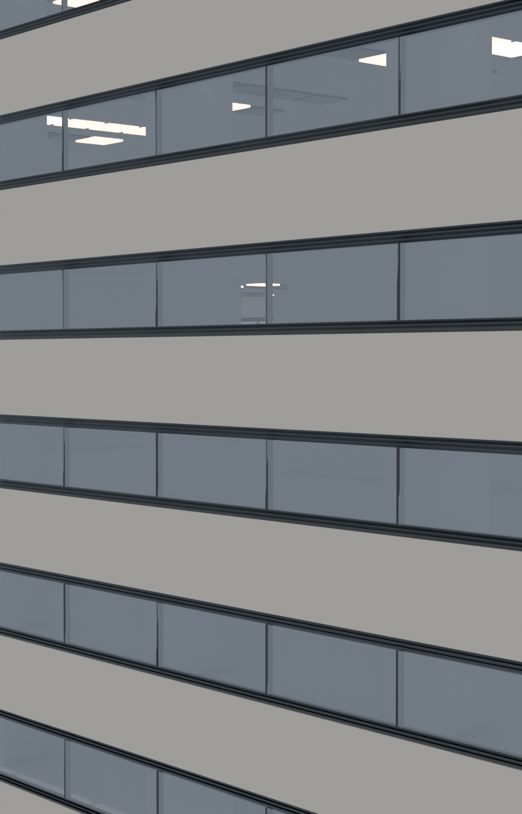 |
| Clear glazing, ventilation strips, horizontal spandrels, mullions, and the varied interior-light modules seen at close range. |

## The Stack

A second, independent procedural study in this repository: an image-led approximation of MVRDV's *The Stack* competition proposal, built by `build_the_stack.py`. It is a slender 115 × 40 m slab rising to 338.8 m, read as a vertical stack of horizontal neighbourhood bands — a double-height retail hall, garden, diagrid, fin and masonry bands. Its identity is the public route up the middle: two service cores run the long axis and, between them, one continuous chain of escalators climbs from the ground hall to the planted roof, stopping at four sky-garden plazas. The office block above the retail hall is 27 uniform 5 m storeys — one plate per storey, and the diamond diagrid runs unbroken over its whole height. In the retail hall the chain is a rectangular helix — a run on each face of the ring at a real escalator pitch, so from above it reads as a 回 that spirals up — kept on the ring floor beside the atrium opening, never across the draughty void. Each plaza is the same two-storey volume — a planted garden deck at the bottom, with the chunky Abeno Harukas-style chevron belt truss rising from that deck and spanning both storeys to the ceiling — and both storeys are wrapped by a folded glass screen: a vertical sawtooth in plan whose outer folds sit on the shared facade plane and whose inner folds are drawn back, so the layer reads as a folding screen and never stands proud of the envelope, with the truss reading through the glass. The garden and its trees grow up through the truss toward the ceiling two storeys above: a vertical mall wrapped in a vertical forest. The fourth plaza sits in the middle of the apartment band, between its two offset voids. Those two voids are ventilation openings either side of the centreline, each as wide as half the span between the cores so it runs from its core to the centreline; each is centred on one of the core's chunky X-brace bays, so the brace reads in the vertical middle of the opening — both vents are the same 10 apartment storeys tall, the lower one standing free in the brick band with the mid-apartment refuge just above it, the upper one opening down onto that refuge's garden roof. The public escalator interlocks big ~30° diagonal flights across the office shaft — two of them crossing over the centre — then reverts to a plain one-plane switchback through the apartment band above. The apartment band is pierced by the two offset voids, each against a core, rather than by a bridge.

Generated and iterated procedurally with **DeepSeek 4.1**.

| Whole building | Apartment curtain wall |
| --- | --- |
| 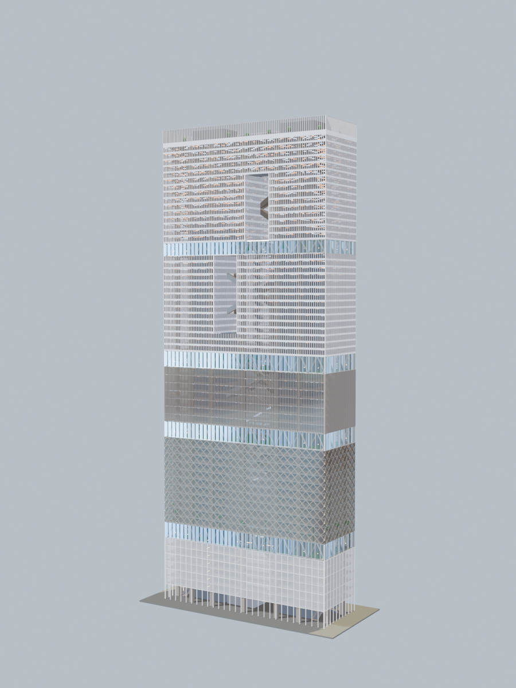 | 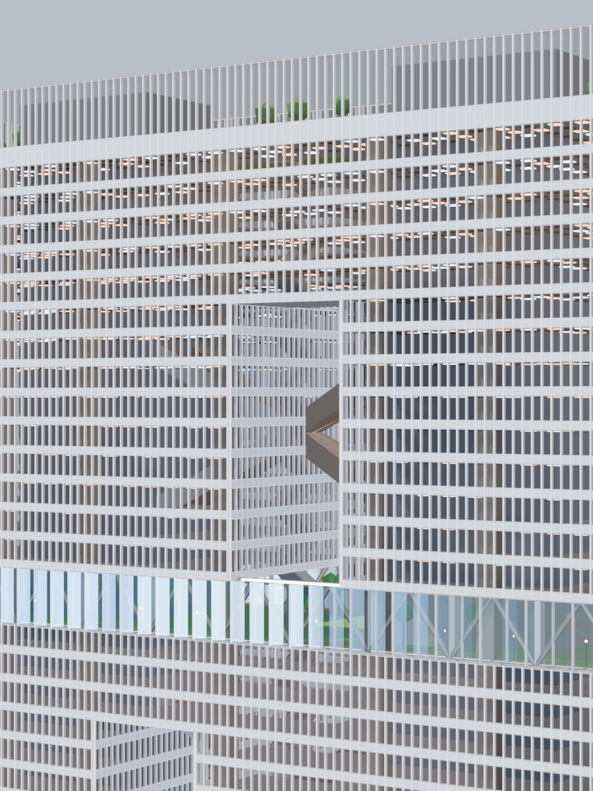 |

| Apartment void | Refuge sky garden |
| --- | --- |
| 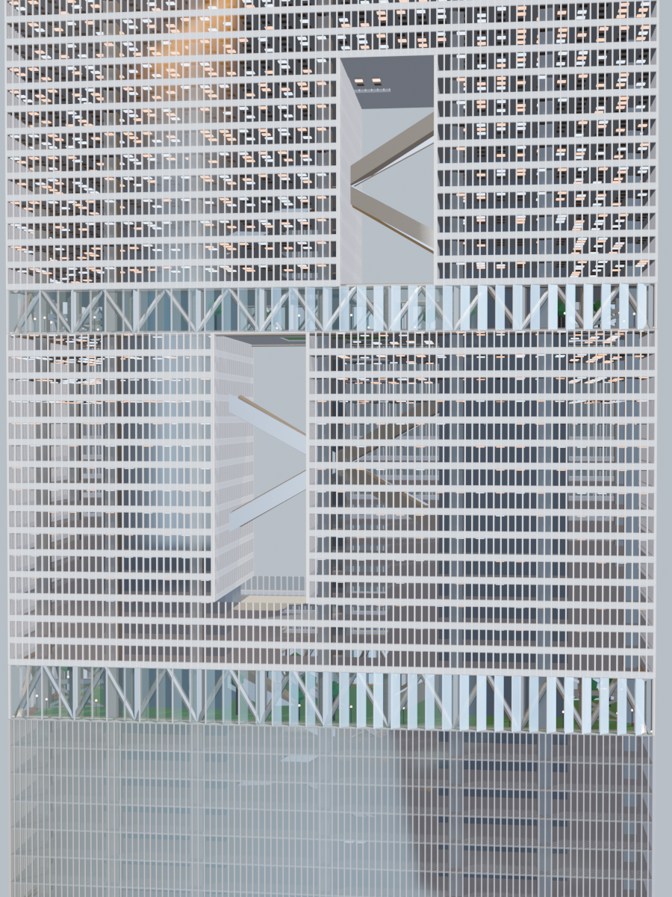 | 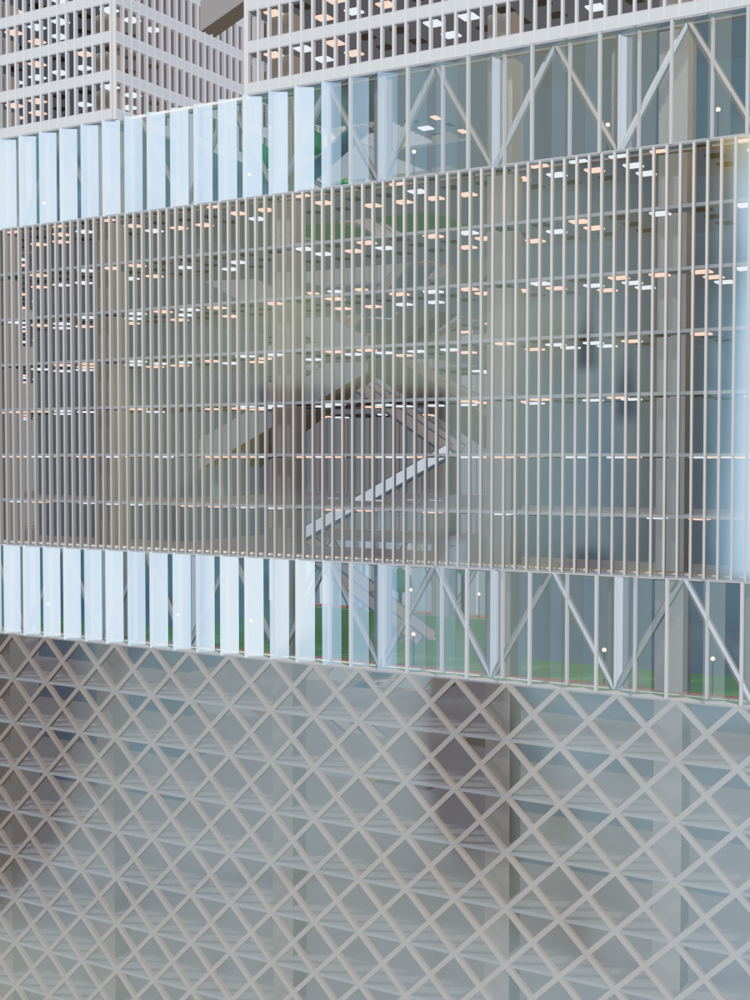 |

| Retail base |
| --- |
| 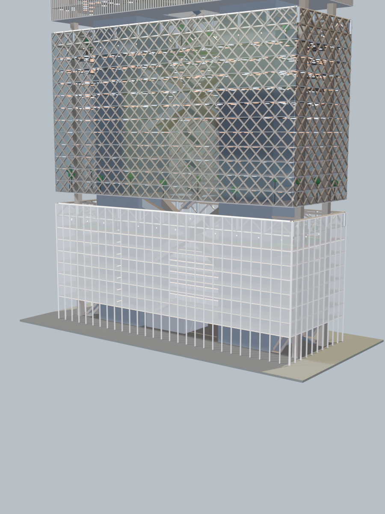 |

### Reference

The generator is an image-led approximation of MVRDV's competition proposal; the
original design (© MVRDV, [mvrdv.com/projects/340/the-stack](https://mvrdv.com/projects/340/the-stack))
is kept here for comparison:

| MVRDV reference — aerial (photo 16064) | MVRDV reference — atrium escalators |
| --- | --- |
| 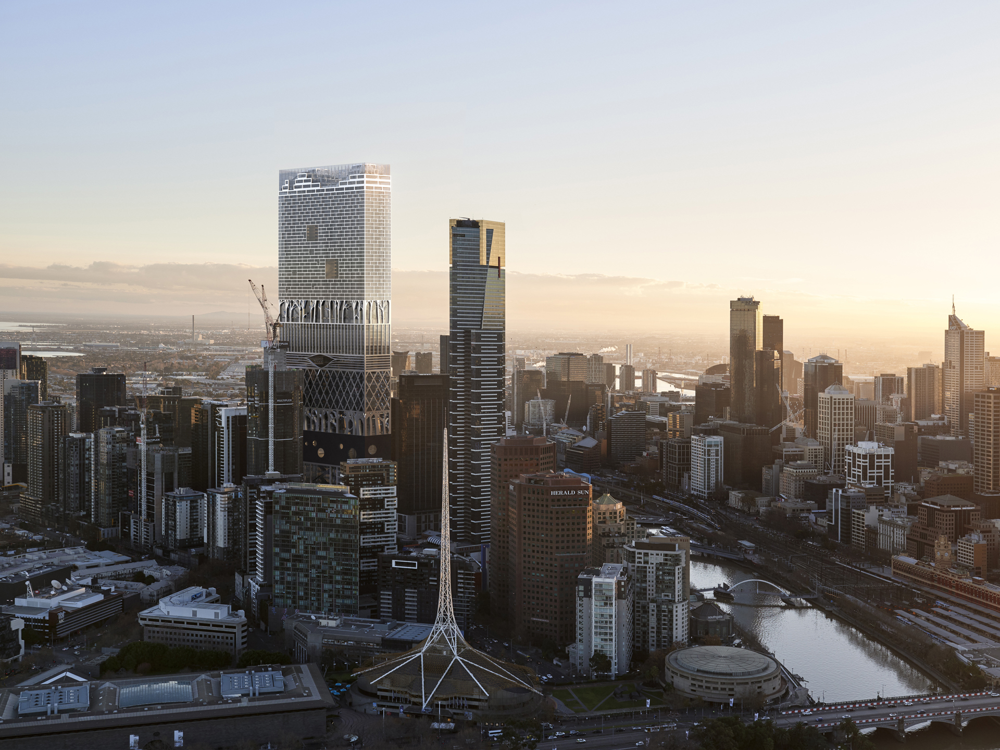 | 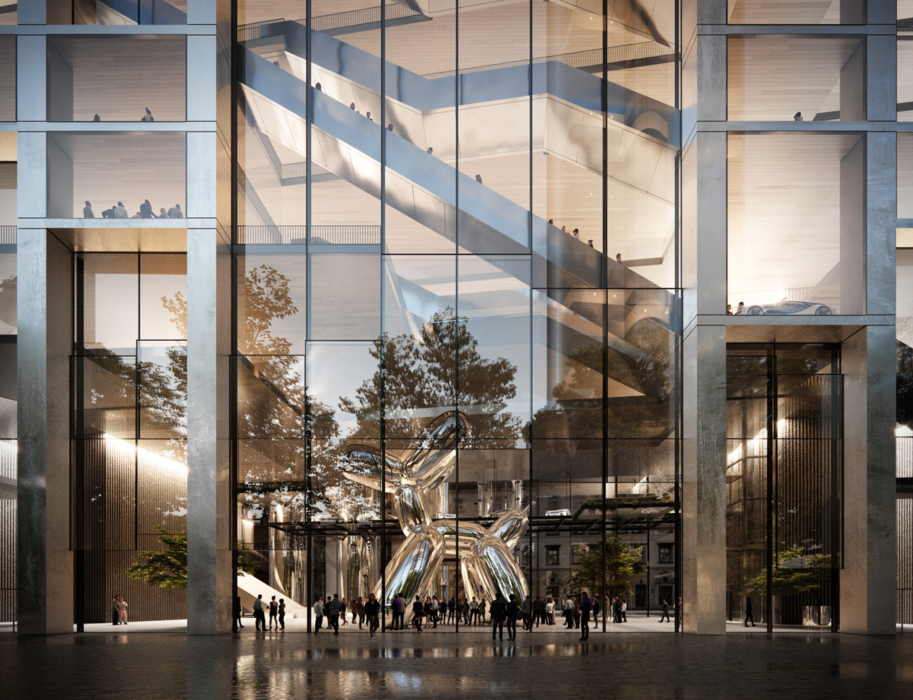 |

Build, render the review views and validate it with:

```bash
blender --background --factory-startup --python-exit-code 1 --python build_the_stack.py
blender --background --factory-startup --python-exit-code 1 --python build_the_stack.py -- --views preview facade garden void base
blender --background --factory-startup --python-exit-code 1 --python verify_the_stack.py -- out/the_stack.blend
blender --background --factory-startup --python-exit-code 1 --python check_stack_zfight.py -- out/the_stack.blend
```

### Export The Stack for the Browser

The web viewer loads a binary glTF file (`.glb`), not the editable Blender file and not OBJ. The export script opens the source `.blend` in memory, merges static mesh objects that share one material, and writes a browser-ready GLB without saving changes back to the source scene:

```bash
blender --background --factory-startup --python-exit-code 1 \
  --python export_the_stack.py -- \
  --profile architectural \
  --compression meshopt \
  --report out/the_stack_web_report.json \
  --source out/the_stack.blend \
  --output web/assets/the_stack.glb

npm run optimize:web -- \
  web/assets/the_stack.glb \
  web/assets/the_stack.optimized.glb \
  --compress meshopt
```

The browser loads `web/assets/the_stack.optimized.glb`. Material merging is enabled by default because browser performance is more sensitive to draw calls than to this model's triangle count. It preserves the geometry, floor slabs, and triangle count; it only reduces the number of independent mesh primitives. Blender EEVEE glass node graphs are translated on the in-memory export copy to glTF transmission/IOR/specular/clearcoat properties so the browser keeps the source glass's transparency and reflection semantics. The `.blend` file is never saved by the exporter. To export without this web optimization:

```bash
blender --background --factory-startup --python export_the_stack.py -- \
  --no-merge-materials
```

To leave all Blender material node graphs untouched during export, add:

```bash
--preserve-materials
```

#### Glass and glTF

The glass problem is not that browsers cannot render glass — it is that glTF cannot
describe the Blender node graph. `materials.make_glass` (EEVEE branch) builds a pane
from `Transparent` + `Anisotropic`/`Glossy` + `Mix Shader`, wired straight into the
Material Output. glTF's material model only covers PBR metallic-roughness plus a
fixed set of extensions, and Blender's exporter maps only a subset of a `Principled
BSDF`. Exported as-is, that mixed node graph is dropped or approximated, and the
glass arrives in the browser opaque or wrong.

`translate_glass_materials()` therefore rewrites the glass on the in-memory export
copy only. It detects a glass-like shader by structure (`_is_glass_like`) and rebuilds
a single `Principled BSDF` (`_make_web_glass`) carrying transmission, IOR, specular,
coat, and alpha. The exporter then writes these as standard extensions —
`KHR_materials_transmission`, `KHR_materials_ior`, `KHR_materials_specular` — which the
browser renders with Three.js's `MeshPhysicalMaterial` (`transmission`, `ior`,
`clearcoat`, alpha blending). The result is an approximation, not true refraction: it
looks right mainly with an environment map, and alpha-blended panes depend on correct
transparency sorting. With `--preserve-materials` the graph is left untouched and the
browser loses the glass semantics. The exporter never writes back to the source `.blend`.

#### Ceiling lights in the viewer

The ceiling fixtures travel in the GLB as emissive panels (`Stack_Room_Lights_Warm`,
`Stack_Room_Lights_Daylight`, and the mall strips). glTF emissive only makes the panel
itself glow. It does not light the floor, the ceiling soffit, or anything else, and
this viewer does not instance one real-time point light per fixture: there are 6277
of them, which will not fit in a shader's light list.

`web/ceiling-glow.js` treats each fixture as a source anyway. It keeps the downward
face of every lit panel, merges the two faces of one panel, then groups the panels
by storey. For each floor vertex it sums the fixtures on the ceiling directly above
that storey. The contribution is inverse-square with a Lambert term from the drop
between fixture and floor, clamped so one nearby panel cannot blow out. The same
fixtures also mark the soffit immediately around themselves. Warm and daylight
fixtures keep their own colours. The sum is stored on the floor mesh as `roomLight`
and shown through a node material, so the plate itself reads as lit when seen through
the glass.

Two practical limits forced extra geometry work. The exported floor plates are a few
huge triangles, so a per-vertex colour turns into a long smear. Horizontal triangles
are split until an edge is about four metres, and floor vertices are snapped onto the
nearest lit storey so a plate reads as a layer from above instead of as a thin edge.
The shared GLB palette also bakes the glass to metalness 1 and roughness 1, and a
physical transmission shader becomes a mirror at a steep downward view, which hides
the rooms. On load, `web/main.js` replaces that glass with a thin transparent pane
(`opacity` 0.08, no transmission) so the lit floors stay visible from the street and
from above. The **Ceiling glow** button turns the contribution on and off.

This is not CUDA and not a path tracer. The machine this was built on is an Apple
M4 with no NVIDIA GPU and no `nvcc`. Walls are not lit, and a floor still shows the
contribution as patches rather than a smooth room wash. The Blender scene is
unchanged: the lighting exists only in the viewer.

The current The Stack web assets are approximately:

```text
Blender-export GLB:  2.80 MB / 20 meshes
Final optimized GLB: 1.64 MB / 11 meshes
Triangles:           198,860
Meshopt:             EXT_meshopt_compression
```

The original editable scene remains `out/the_stack.blend`. The web asset is loaded by `web/index.html` through Three.js's `GLTFLoader` with `MeshoptDecoder`. The exporter supports `--profile static`, `--profile animated`, and `--profile architectural`; animated exports do not merge meshes. It also accepts `--compression draco`, `--compression meshopt`, `--compression none`, `--report`, `--no-merge-materials`, and `--preserve-materials`. LOD is intentionally not applied automatically because generic geometric decimation can damage glass, floors, instances, and animation semantics; runtime resolution and on-demand rendering are enabled in the viewer instead.

## The Stack 2

A second-generation rework of the same MVRDV *The Stack* study, built by
`build_stack2.py` and kept alongside the first generation above. It shares the
massing and the public escalator route but reworks the envelope and the program:

- **One continuous curtain wall.** Every storey is the same 4 m, so all four
  refuge belt trusses match, and the envelope reads floor by floor: a fine-mullion
  apartment skin above, and a dense 270 Park Avenue-style office band (0.95 m
  mullions, continuous glass with no blank spandrel, a slim transom 1 m above each
  floor) below.
- **Glazed void reveals.** The reveals of the two ventilation voids — both jambs
  and the soffit — are dressed in the same apartment curtain-wall skin, so each
  cut-out reads as a finished glazed recess and the exterior surface stays
  unbroken. The long faces and the void deck stay open.
- **Taller crown.** The two apartment groups run 15 storeys each, and the block
  above the upper void grows from two storeys to six, so the roof plate sits at
  288 m, the glass tops out at 298.8 m, and the 1.2 m frame cap brings the tower
  to 300 m over 72 floors. The refuge truss bands are the horizontal separators:
  they carry no facade frame, so every 4 m storey stays clear.

| Whole building | Apartment curtain wall |
| --- | --- |
| 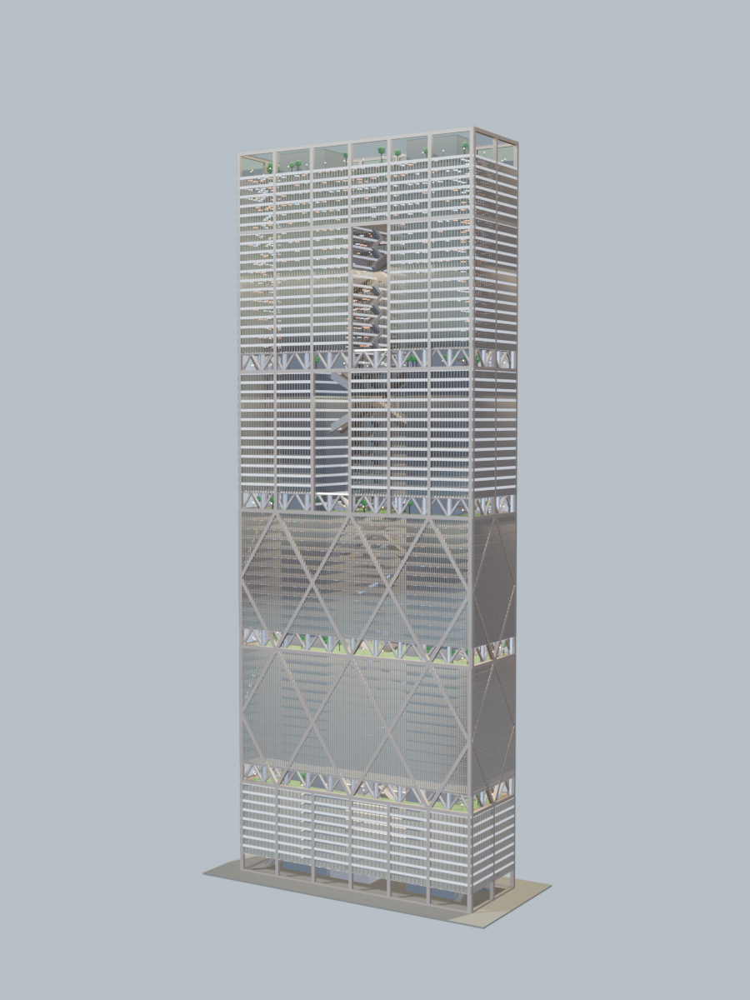 | 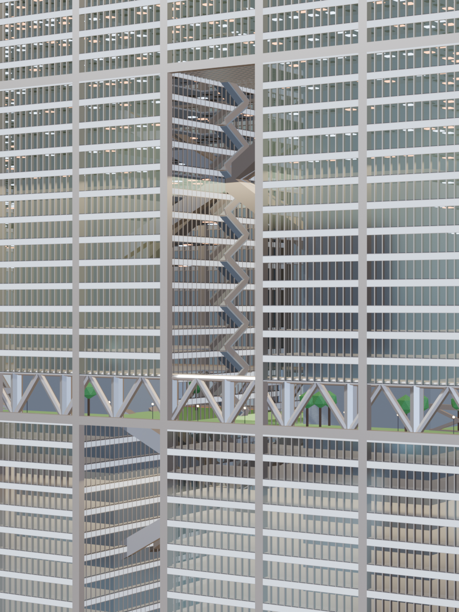 |

| Apartment void (glazed reveal) | Refuge sky garden |
| --- | --- |
| 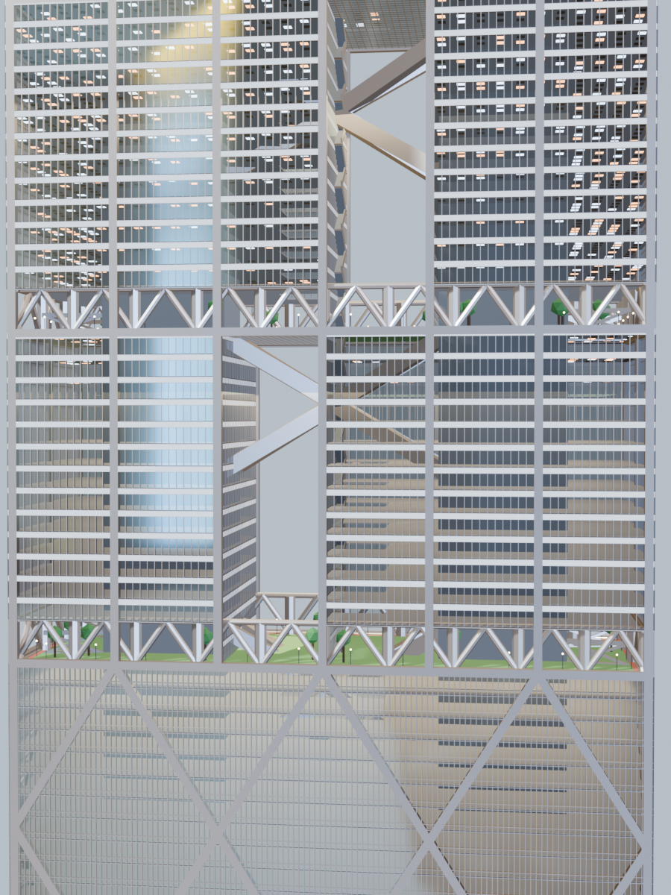 | 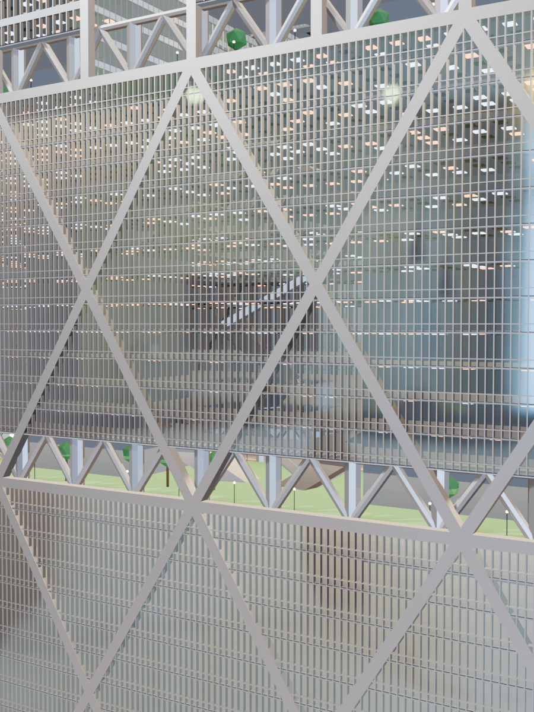 |

| Retail base |
| --- |
| 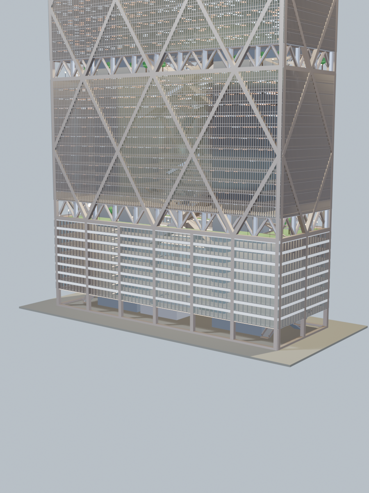 |

Build and render the review views with:

```bash
blender --background --factory-startup --python-exit-code 1 --python build_stack2.py
blender --background --factory-startup --python-exit-code 1 --python build_stack2.py -- --views preview facade garden void base
blender --background --factory-startup --python-exit-code 1 --python check_stack_zfight.py -- out/the_stack2.blend
```

## The Stack 3

A third-generation study of the same MVRDV *The Stack* proposal, built by
`build_stack3.py`. Where the first two generations read the tower as a glass
slab in a chunky frame cage, this one goes back to the published elevation and
section sheets and models what gives the building its identity: a vertical
stack of neighbourhoods, each with its own facade language.

The envelope follows the client direction for this generation: a little over
100 m wide and only 36 m deep, i.e. a very flat slab. The model uses a 108 x 36 m
plan; the crown was then dropped at the client's request, so the stack stops at
the apartment band and the roof is completely flat at 302 m (303.6 m to the
parapet). That is a 2.80 : 1 wide elevation, squatter than the published sheet
(3.09 : 1) because the lower block lost one lattice tier at the client's
direction, but it keeps the 36 m depth.

Three bands, bottom to top, each a different facade system, with metal cornices
as the "stack" lines between them. Below the apartments the storey is 5 m, so the
lower block carries 37 floors in that height; the apartments keep their 4 m
module and run 28 floors.

- **Lattice, 0-158 m.** The whole lower block is one facade: an external frame six
  bays wide by five tiers tall. The bottom two tiers are framed cells - six big
  glazed squares per row, closed by thick members, no X - and the upper three
  tiers are diagonal only: an X in every cell, no intermediate verticals and no
  horizontal bands, just the corner posts and the diamond grid. The frame carries vertical posts only: no added horizontal
  band, the floor line is the dark slab edge itself; every floor plate in the
  model is near-black. Behind it is one dark glass skin with no visible pane
  joints at all - no mullions between the panes. Every floor, here and in the
  planted level, is lit the same way as the apartments: one long cool-or-warm
  ceiling strip per room.
- **Plaza, 158-188 m.** A planted arcade of branching tree columns and planting,
  open through - no interior wall - with the same room strips on its floors.
- **Apartments, 188-302 m.** A semi-transparent glazed skin drawn as a staggered
  block grid: every bay is one 4 m storey of glass, laid in a half-bond running
  course, and the external frame around the bays is the window pattern itself -
  there are no punched openings. Three near-identical glass tints and a lit
  ceiling in every bay keep it reading as apartments at dusk - no wall behind the
  glass. A two-metre metal fascia closes the grid at the roof.
- **Night lighting.** Six studio area lights outside, plus 48 simulated interior
  point lights scattered at random plan positions and heights standing in for
  the thousands of fixtures, warm and cool. Floor plates neither take light nor cast shadow, so the interior
  glow carries up and down the shaft instead of pooling on one plate.
- **Flat roof, 302 m.** The tower stops at the apartment band: one deck slab and
  a 1.2 m parapet, nothing above it.

The shallow plan is what makes the strata legible: with only 36 m of depth the
long faces stay almost flat and the bands read as continuous horizontal ribbons,
while the short faces show the same sequence compressed into a narrow slice. Two
service cores stand on the long axis, so the glazed bands read as occupied floors
rather than a hollow box. The review renders use a dusk sky and a low sun: the
published model photography is shot on a dark ground, and a dark sky is also what
keeps the glazing reading as glass instead of as a mirror of a bright overcast
dome.

| Whole building | Elevation |
| --- | --- |
| 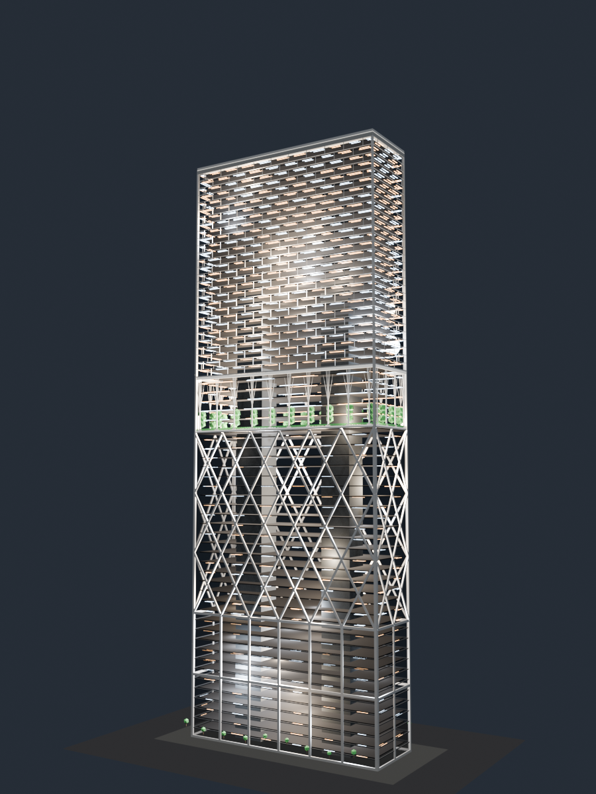 | 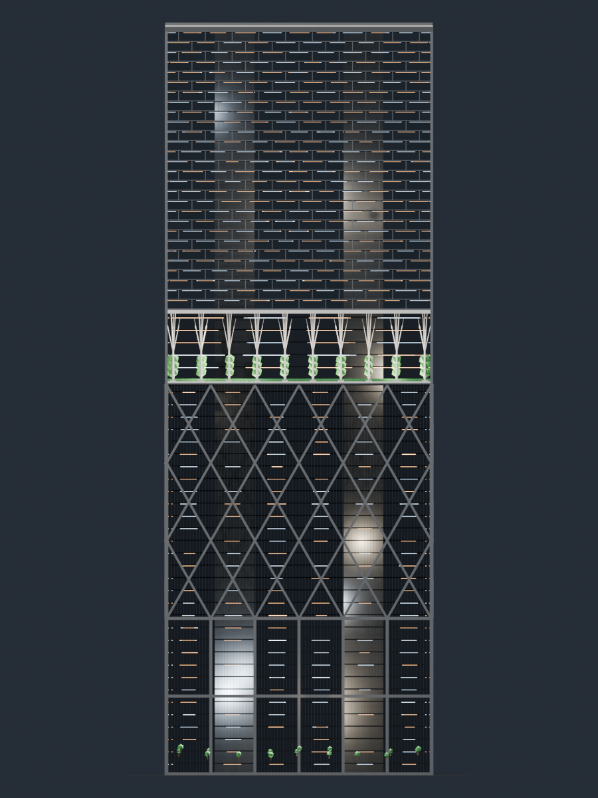 |

| Retail base | Glazed apartment bays |
| --- | --- |
| 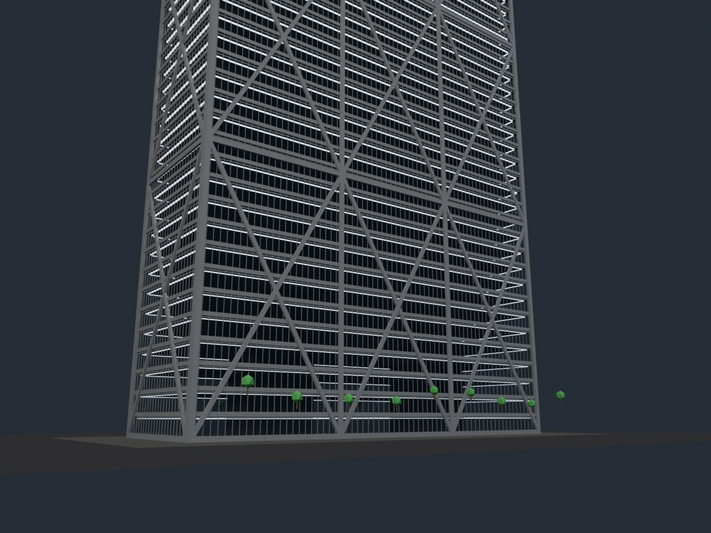 | 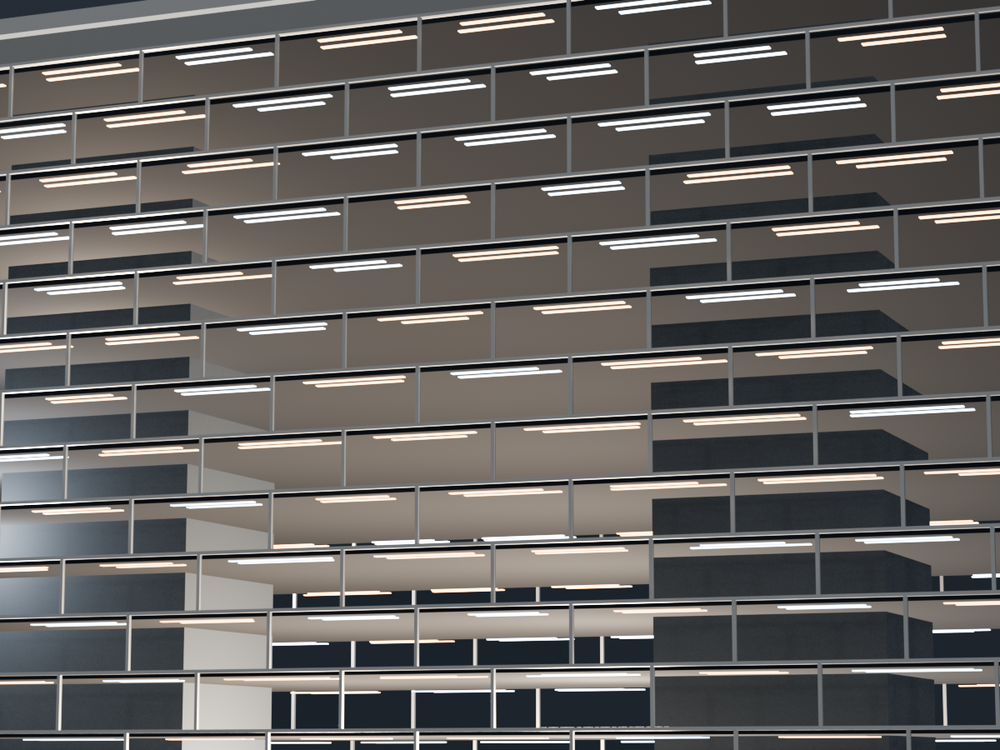 |

| Narrow face |
| --- |
| 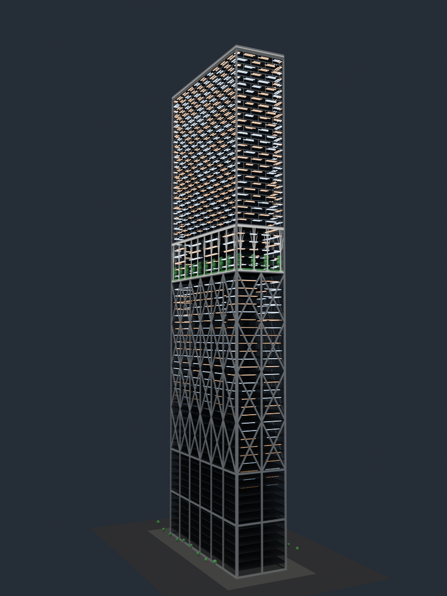 |

Build, render and verify with:

```bash
blender --background --factory-startup --python-exit-code 1 --python build_stack3.py
blender --background --factory-startup --python-exit-code 1 --python build_stack3.py -- --views preview elevation base detail side
blender --background --factory-startup --python-exit-code 1 --python verify_stack3.py -- out/the_stack3.blend
```

The saved `.blend` opens with an exterior viewport view baked in: about 200 m
out from the slab, 3/4 angle, Material Preview, with the viewport lens left at
its normal 50 mm (no wide-angle distortion). From 200 m a 350 m tower does not
fit in frame; `Home` frames the whole model, and `Numpad 0` shows the separate
whole-building render camera.

## Repository Structure

```text
build_house.py       # Procedural generation of the residential towers and podium
build_office.py      # Separate procedural office-tower study
build_the_stack.py   # The Stack study, first generation
build_stack2.py      # The Stack study, second generation
build_stack3.py      # The Stack study, third generation (stacked bands)
verify_the_stack.py  # Validation for the first-generation Stack scene
verify_stack3.py     # Envelope, band and mesh checks for the third generation
materials.py         # Stone, glass, metal, lighting, and planting materials
render_views.py      # Batch rendering of presentation views
verify_house.py      # Geometry, facade-module, and scene validation
floor_plan.py        # Floor-plan output
open_in_blender.py   # Opens the scene in Material Preview
export_the_stack.py  # Browser-oriented GLB export and optimization report
package.json         # glTF Transform post-processing command
view.sh              # Convenience command for opening the saved Blender scene
out/                 # Local build products; ignored by Git
web/                 # Three.js viewer and web assets
docs/images/         # Images displayed in this README
```

## Usage

Blender 5.x is required. The project is currently developed with Blender 5.2.0 LTS.

### Build the Scene

```bash
blender --background --factory-startup --python build_house.py
```

The build writes the following files to `out/`:

- `highrise_house.blend`: the complete editable scene
- `highrise_house.glb`: a glTF export for web and other DCC viewers
- `preview.png`: the overall preview render

Append `--no-render` to generate the model without rendering the preview.

### Open the Scene

```bash
./view.sh
```

This opens `out/highrise_house.blend` and switches the 3D viewport to Material Preview. Blender's default Solid mode ignores the project materials and otherwise displays the model as a flat grey mass.

### Render Presentation Views

```bash
blender --background --factory-startup --python render_views.py -- out/highrise_house.blend
```

The renderer writes all views to `out/`, including two reproducible ground-level upward views. The README images are repository snapshots stored in `docs/images/`, allowing GitHub to display the project without relying on external release assets.

### Run Validation

```bash
blender --background --factory-startup --python verify_house.py -- out/highrise_house.blend
```

The verifier checks tower dimensions, floor and window modules, glazing, service cores, sky gardens, podium continuity, pilotis clearance, and saved viewport settings. The current saved scene includes later three-level podium and truss-height adjustments, so several older assertions still report baseline mismatches and need to be synchronized with the latest design.

## Parametric Model

Key dimensions are derived from window count, floor height, and residential-group count instead of being assembled as fixed masses. Adding one 4 m module to a long facade increases the corresponding tower width by exactly 4 m. Changing the residential group count updates the floors, core tops, sky-garden positions, and camera framing together.

The two residential tower configurations are defined by the `configure_tower()` calls in `build_house.py`:

```python
configure_tower(2, 18, core_column_bays=2)  # Existing tower
configure_tower(3, 20, core_column_bays=3)  # Adjacent tower
```

Materials are centralized in `materials.py`. The default palette combines warm pale stone, neutral transparent glass, dark anodized metal, and subdued green planting. Interior depth comes from discrete ceiling fixtures with deterministic warm, cool, and off states rather than a uniformly emissive surface placed behind the glazing.

## Current Status

The current scene is saved as `out/highrise_house.blend`. The README imagery has been captured and rendered from that scene, including the two ground-level upward views. Scene building and batch rendering are reproducible; validation runs successfully but still contains several podium and truss assertions based on an earlier scene baseline.
